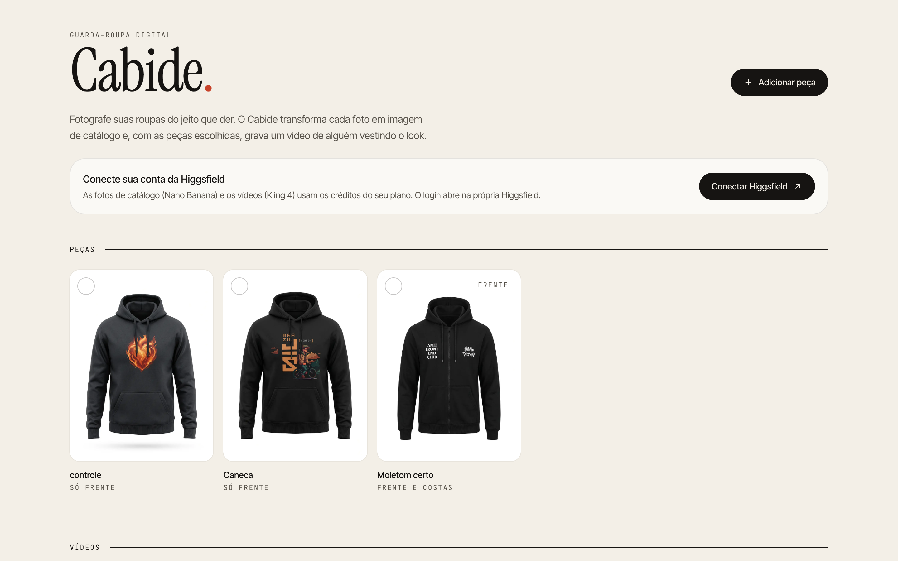
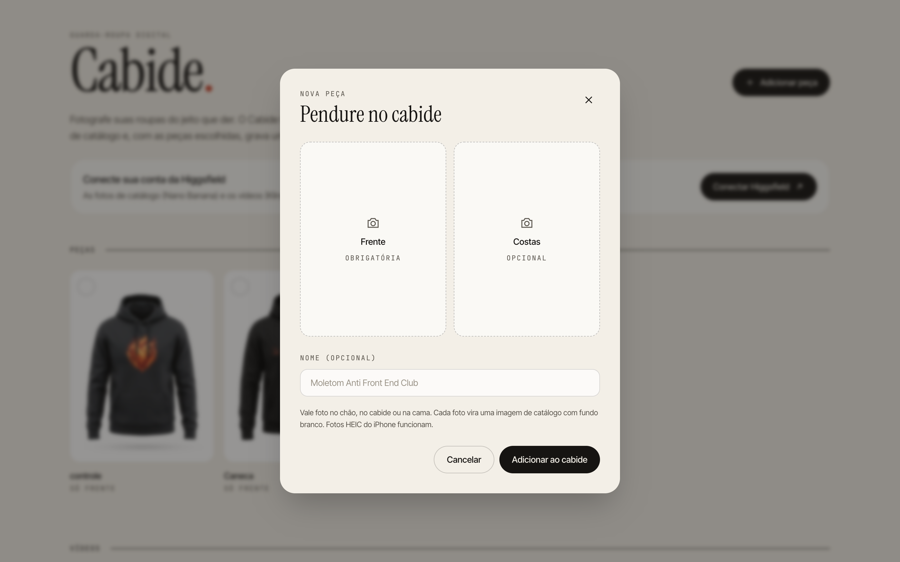
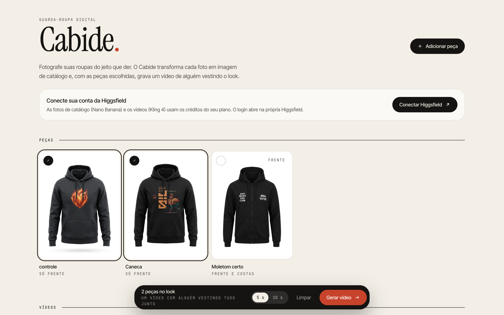
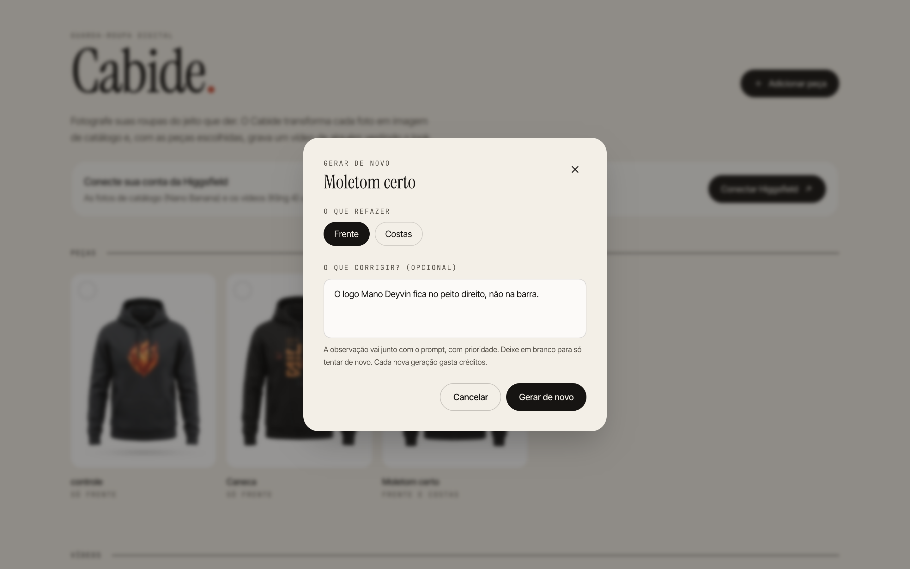
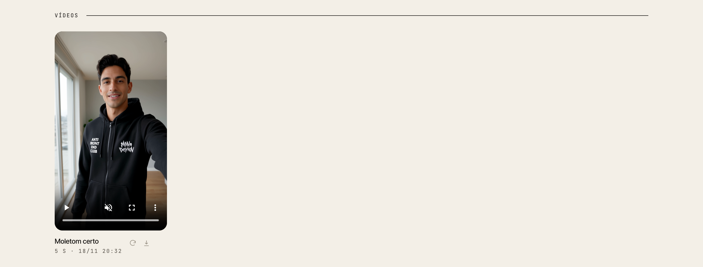
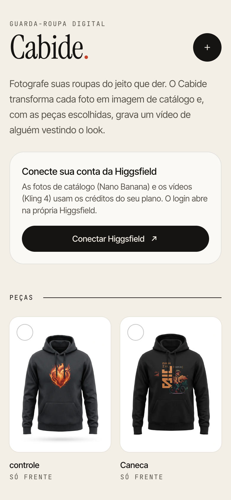

# Cabide

Guarda-roupa digital: você fotografa suas roupas do jeito que der, o Cabide transforma cada foto em uma
**imagem de catálogo com fundo branco** e, com as peças escolhidas, grava um **vídeo UGC** de alguém vestindo o look.

As imagens e os vídeos são gerados pela [Higgsfield](https://higgsfield.ai): **Nano Banana 2.1** para o catálogo
(ghost mannequin) e **Kling 4.0** para o vídeo.



## Como funciona

1. **Adicione a peça.** Foto da frente (obrigatória) e das costas (opcional). Vale foto no chão, na cama ou no cabide, e HEIC do iPhone funciona.
2. **Catálogo automático.** Cada foto vira uma imagem de loja em fundo branco, com as estampas preservadas. O card se atualiza sozinho quando fica pronta.
3. **Monte o look.** Selecione uma ou mais peças prontas, escolha 5 s ou 10 s e toque em **Gerar vídeo**.
4. **Ajuste o que não ficou bom.** Qualquer foto ou vídeo pode ser gerado de novo, com uma observação opcional para o modelo.

| Adicionar peça | Selecionar o look |
| --- | --- |
|  |  |

| Gerar de novo com uma observação | Vídeo UGC gerado |
| --- | --- |
|  |  |

No celular, a galeria vira duas colunas e os botões ficam sempre visíveis:



## Stack

- Ruby 3.4 + **Rails 8.1**, SQLite, Active Storage em disco
- **Solid Queue** (dentro do Puma) para os jobs de geração e polling
- **Turbo Streams + Solid Cable** para atualizar a galeria ao vivo
- Tailwind CSS 4, Stimulus e importmap
- libvips + libheif para converter fotos HEIC
- Gem oficial [`mcp`](https://github.com/modelcontextprotocol/ruby-sdk) (cliente MCP + OAuth 2.1/PKCE)
- Tudo roda em **Docker** (`docker-compose.yml` + `Dockerfile.dev`)

## Rodando

Pré-requisito: Docker.

```bash
cp .env.example .env
```

Gere as três chaves de criptografia (protegem o token da Higgsfield guardado no SQLite) e cole no `.env`:

```bash
ruby -rsecurerandom -e '3.times { puts SecureRandom.alphanumeric(32) }'
```

```bash
docker compose up --build
```

Abra http://localhost:3000 e clique em **Conectar Higgsfield**. O login acontece na própria Higgsfield, e o Cabide
guarda o token criptografado no SQLite. O saldo de créditos aparece no topo da página. Se a sessão expirar, o card
**Conectar Higgsfield** volta a aparecer.

> O redirect do login é `http://localhost:3000/higgsfield/callback`, então acesse o app por `localhost:3000`.

## Integração com a Higgsfield

Há dois backends com a mesma interface, escolhidos por `HF_BACKEND` no `.env`:

| | `mcp` (padrão) | `api` |
| --- | --- | --- |
| Conexão | Servidor MCP oficial (`https://mcp.higgsfield.ai/mcp`), login OAuth no app | API REST com chave `HF_API_KEY=<id>:<secret>` |
| Créditos | Do plano da sua conta | Saldo pré-pago da API |
| Catálogo | Nano Banana 2.1 | Grok Image 2.0 (Nano Banana não está liberado na API) |
| Vídeo | Kling 4.0 reference-to-video | Kling O3 image-reference |

Os modelos e parâmetros ficam em [`config/higgsfield.yml`](config/higgsfield.yml) e podem ser trocados por variáveis
de ambiente (`HF_MCP_IMAGE_MODEL`, `HF_MCP_VIDEO_MODEL`, `HF_IMAGE_ENDPOINT`, `HF_VIDEO_ENDPOINT`), sem mexer em código.

### Fluxo de geração

```
foto (HEIC/JPG) ──► JPEG ──► media_upload + PUT + media_confirm ──► generate_image_batch (Nano Banana)
                                                                           │
                                              PollGenerationJob ◄── jobs_wait (a cada 5 s)
                                                     │
                                         baixa o resultado ──► Active Storage ──► Turbo Stream no card

peças selecionadas ──► job ids das fotos de catálogo ──► generate_video_batch (Kling 4.0) ──► mesmo polling
```

Os prompts estão em [`app/services/higgsfield/prompts.rb`](app/services/higgsfield/prompts.rb). A observação digitada em
**Gerar de novo** é acrescentada ao fim do prompt com prioridade.

### Onde está cada coisa

| Arquivo | Papel |
| --- | --- |
| `app/services/higgsfield/mcp/session.rb` | Cliente MCP autenticado (OAuth, chamada de ferramentas) |
| `app/services/higgsfield/mcp/generation.rb` | Upload, geração e polling via MCP |
| `app/services/higgsfield/api/generation.rb` + `client.rb` | Mesmo fluxo pela API REST |
| `app/services/higgsfield/results.rb` | Conversão para JPEG, download do resultado, mensagens de erro |
| `app/jobs/submit_generation_job.rb`, `poll_generation_job.rb` | Envio, polling, retries e falhas |
| `app/models/higgsfield_connection.rb` | Token OAuth criptografado + PKCE pendente |
| `app/views/garments/`, `app/views/videos/` | Galeria, cards, seleção e vídeos |

## Testes

```bash
docker compose exec -e RAILS_ENV=test web bin/rails test
```

Os testes não chamam a Higgsfield de verdade: a API é simulada com WebMock e o MCP com uma sessão falsa
([`test/support/fake_mcp_session.rb`](test/support/fake_mcp_session.rb)).

## Limitações do MVP

- Sem login de usuário: é um guarda-roupa único, pensado para rodar localmente.
- O MCP da Higgsfield foi feito para assistentes de IA; nomes e campos das ferramentas podem mudar sem aviso.
- Estampas pequenas fotografadas de lado podem sair fora do lugar. Use **Gerar de novo** com uma observação.
